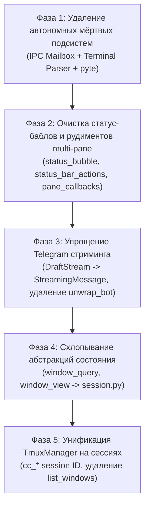

# Poka-Yoke Minimalism Refactoring Plan

## 1. Архитектурный аудит и системные выводы

Текущий объём исходного кода: **24 208 строк Python** (106 файлов в `src/ccgram/`) плюс свыше 18 000 строк тестов.

Аудит показал, что кодовая база содержит значительное количество архитектурных слоёв, оставшихся от предыдущих эволюционных этапов проекта (когда поддерживались внешние сессии, эмуляция VT100 через `pyte`, интер-агентский IPC через файловый ящик, статус-баблы в Telegram и модель «несколько окон в одной мастер-сессии»).

При этом актуальная модель проекта проста и зафиксирована:
> **1 рабочий топик Telegram = 1 сессия tmux (`cc_<name>`) с привязкой `@ccgram_topic = <chat_id>:<thread_id>`.**

Всё, что выходит за рамки прямого двустороннего обмена между Telegram-топиком и соответствующей tmux-сессией, подлежит удалению по принципам **Poka-Yoke** (устранение возможности ошибки за счёт физического отсутствия избыточных состояний и механизмов).

---

## 2. Системные предложения по упрощению

### Предложение 1. Полное удаление подсистемы меж-агентского IPC (`mailbox`, `msg_*`, `spawn_request`)

#### Что конкретно удалить
- **Файлы ядра**:
  - `src/ccgram/mailbox.py` (592 строки)
  - `src/ccgram/msg_cmd.py` (546 строк)
  - `src/ccgram/msg_discovery.py` (187 строк)
  - `src/ccgram/spawn_request.py` (236 строк)
- **Файлы обработчиков**:
  - Всю директорию `src/ccgram/handlers/messaging/` целиком (1 210 строк):
    - `msg_broker.py` (353 строки)
    - `msg_delivery.py` (149 строк)
    - `msg_spawn.py` (239 строк)
    - `msg_telegram.py` (391 строка)
- **Точки интеграции**:
  - Вызовы `msg_broker.poll()` и `msg_spawn.poll_spawn_requests()` в `src/ccgram/handlers/polling/periodic_tasks.py`.
  - CLI subcommand `msg` в `src/ccgram/cli.py`.
  - Методы `get_mailbox()` в `session.py`, `cleanup.py`, `bootstrap.py`.
- **Тесты**: 7 тестовых файлов (`test_mailbox.py`, `test_spawn_request.py`, `test_msg_broker.py`, `test_msg_spawn.py` и др. — всего ~2 900 строк).

#### Почему они избыточны
Это автономная файловая шина сообщений между агентами через директории `~/.ccgram/mailboxes` и `~/.ccgram/spawn_requests`. Она не входит в Telegram-интерфейс бота (`//commands`), не используется при обычном взаимодействии пользователя с терминалом, но каждые 2 секунды опрашивает диск в фоне.

#### Упрощённая архитектура
Вся передача сообщений в Telegram обслуживается исключительно модулями пайплайна доставки `src/ccgram/handlers/messaging_pipeline/` (`message_queue.py`, `message_sender.py`, `tool_batch.py`). Полностью устраняется путаница между двумя пакетами со схожими именами (`handlers/messaging` и `handlers/messaging_pipeline`).

#### Устраняемые состояния, зависимости и пути выполнения
- Фоновый поллинг файловой системы (`~/.ccgram/mailboxes/*`, `~/.ccgram/spawn_requests/*`).
- Механизм согласования (approval flow) создания новых агентов через инлайн-кнопки в Telegram.
- Состояния доставки сообщений (`pending`, `delivered`, `dead-letter`).

#### Как это предотвращает ошибки (Poka-Yoke)
Невозможно получить рассинхронизацию файлового ящика, гонки при записи JSON на диск, утечки файловых дескрипторов или ложные срабатывания фонового поллинга.

#### Риски и проверка
- **Риск**: CLI-команда `ccgram msg` перестанет существовать.
- **Проверка**: убедиться, что ни один реальный пользователь или процесс не опирается на `ccgram msg`.

#### Оценка сокращения кода
- **~2 770 строк** в `src/`
- **~2 900 строк** в `tests/`
- **Итого**: ~5 670 строк.

---

### Предложение 2. Удаление неиспользуемой эмуляции терминала (`terminal_parser`, `screen_buffer`, `pyte`)

#### Что конкретно удалить
- `src/ccgram/terminal_parser.py` (738 строк)
- `src/ccgram/screen_buffer.py` (71 строка)
- Метод `parse_with_pyte()` и свойства в `src/ccgram/handlers/polling/polling_state.py` (~70 строк).
- Зависимость `pyte>=0.8.2` в `pyproject.toml`.
- Тест `tests/ccgram/test_terminal_parser.py` (980 строк).

#### Почему они избыточны
В коде `decide.py` и `observe.py` явно зафиксировано:
```python
def build_status_line(status: StatusUpdate | None) -> str | None:
    """Status lines are disabled in simplified polling model."""
    return None
```
Функция `_parse_with_pyte` ни разу не вызывается в рантайме. Файл `terminal_parser.py` (738 строк сложных регулярных выражений для парсинга спиннеров и меню Claude) фактически тестирует сам себя и больше нигде не задействован. Передача вывода терминала в Telegram надёжно реализована через текстовый diff в `topic_status_diff.py` и захват в `shell_capture.py`.

#### Упрощённая архитектура
Поллинг экрана терминала базируется исключительно на прямом вызове `tmux capture-pane` с сохранением хеша предыдущего содержимого и формированием понятного diff через `topic_status_diff.py`.

#### Устраняемые состояния, зависимости и пути выполнения
- Виртуальный VT100-экран `pyte.Screen` и `HistoryScreen`.
- Внешняя зависимость `pyte`.
- Кэш хэшей экрана для парсера статуса.

#### Как это предотвращает ошибки (Poka-Yoke)
Полностью исключаются ошибки рассинхронизации размеров экрана (`columns/rows`), сбои при обработке нестандартных ANSI-последовательностей эмулятором `pyte` и накладные расходы процессора на парсинг текста.

#### Риски и проверка
- **Риск**: минимальный (код не вызывается в рантайме).
- **Проверка**: запуск `pytest tests/ccgram/handlers/polling/` для подтверждения целостности поллинга.

#### Оценка сокращения кода
- **~880 строк** в `src/`
- **~980 строк** в `tests/`
- **Итого**: ~1 860 строк + удаление внешней зависимости `pyte`.

---

### Предложение 3. Замена `DraftStream` с фиктивным API на прямой `StreamingMessage`

#### Что конкретно удалить
- Стейт-машину попыток вызова несуществующего метода `sendMessageDraft` в `src/ccgram/telegram_draft.py` (501 строка).
- Глобальное состояние деградации (`_DRAFT_UNAVAILABLE`, `_UNSUPPORTED_PEERS`).
- Хак `unwrap_bot` в `src/ccgram/telegram_client.py`.
- Тесты деградации `test_telegram_draft.py`.

#### Почему они избыточны
`sendMessageDraft` — это неофициальный метод, отсутствующий в публичном Telegram Bot API. При каждом запуске стрима первый запрос падает с `BadRequest: method not found`, после чего стрим переключается в legacy-режим (`send_message` + `edit_message_text`). Ради этого в проекте содержится 500 строк логики с отслеживанием отказов по каждому пиру, а в клиенте сделана дыра `unwrap_bot`, нарушающая контракт `TelegramClient`.

#### Упрощённая архитектура
Единый класс `StreamingMessage` (~100 строк):
- `start(text)`: отправляет сообщение через `client.send_message()`.
- `append(chunk)` / `replace(text)`: обновляет буфер и выполняет дебаунсированный `client.edit_message_text()`.
- `finalize()`: отправляет финальное состояние.
Никаких вызовов `do_api_request("sendMessageDraft")`, никаких fallback-веток и проверок версий Bot API.

#### Устраняемые состояния, зависимости и пути выполнения
- Состояния деградации (`streaming -> legacy`).
- Кэш `_UNSUPPORTED_PEERS`.
- Прямой доступ к объекту `telegram.Bot` в обход интерфейса `TelegramClient`.

#### Как это предотвращает ошибки (Poka-Yoke)
Каждый вызов всегда идёт по **одному предсказуемому пути** через официальный стабильный метод API Telegram. Отсутствуют скрытые сетевые ошибки при старте потока.

#### Риски и проверка
- **Риск**: незначительное изменение частоты обновления сообщений при стриминге (регулируется дебаунсом в 0.5-1.0 сек, чтобы не упираться в Telegram Rate Limits).
- **Проверка**: тесты `tool_batch.py` и `shell_commands.py`.

#### Оценка сокращения кода
- **~400 строк** в `src/`
- **~300 строк** в `tests/`
- **Итого**: ~700 строк.

---

### Предложение 4. Удаление фантомных статус-баблов и рудиментов multi-pane

#### Что конкретно удалить
- `src/ccgram/handlers/status/status_bubble.py` (403 строки)
- `src/ccgram/handlers/status/status_bar_actions.py` (316 строк)
- Пустышку `update_topic_emoji()` в `src/ccgram/handlers/status/topic_emoji.py` (переименование топиков при смене статуса отключено, функция только логирует debug).
- Рудименты подписки на пейны в `src/ccgram/handlers/live/pane_callbacks.py` (265 строк) и перехват переименования пейна в `src/ccgram/handlers/text/text_handler.py`.
- Задачи `StatusUpdateTask` и `StatusClearTask` в `message_task.py` и `message_queue.py`.

#### Почему они избыточны
- В документации и коде зафиксировано: статус-баблы удалены. `enqueue_status_update` вызывается исключительно со значением `None` в процедурах очистки. Однако 700+ строк кода генерации клавиатур, рендеринга и обработки коллбэков статус-бабла до сих пор присутствуют в репозитории.
- Механизм подписки на пейны (`PaneStatusStrategy`) был удалён ранее, но файл `pane_callbacks.py` остался, а обработчик текстовых сообщений `text_handler.py` на каждое входящее сообщение проверяет, не вводит ли пользователь имя для пейна.

#### Упрощённая архитектура
- Очередь сообщений `src/ccgram/handlers/messaging_pipeline/message_queue.py` работает только с реальными задачами контента (`ContentTask`).
- При закрытии топика или сессии вызывается простая прямая очистка сохранённых ID сообщений без прогона пустых фиктивных тасок через очередь.
- Текстовый обработчик `text_handler.py` сразу передаёт ввод в shell/сессию без промежуточных перехватов несуществующего переименования пейнов.

#### Устраняемые состояния, зависимости и пути выполнения
- Типы задач `StatusUpdateTask` и `StatusClearTask`.
- Словарь `_status_drafts`.
- Обработчики коллбэков `CB_STATUS_*` и `CB_PANE_*`.
- Флаги сессии `PANE_RENAME_*`.

#### Как это предотвращает ошибки (Poka-Yoke)
Очередь сообщений становится однородной (только отправка контента). Устраняются гонки между статусными сообщениями и сообщениями вывода терминала.

#### Риски и проверка
- **Риск**: нулевой, так как статус-баблы уже не отправляются.
- **Проверка**: сквозной сценарий отправки команд и очистки топика.

#### Оценка сокращения кода
- **~1 050 строк** в `src/`
- **~800 строк** в `tests/`
- **Итого**: ~1 850 строк.

---

### Предложение 5. Схлопывание многослойной абстракции состояния сессий

#### Что конкретно удалить и объединить
- **Удалить файлы-прослойки**:
  - `src/ccgram/window_view.py` (32 строки)
  - `src/ccgram/window_query.py` (105 строк)
  - `src/ccgram/session_resolver.py` (226 строк)
  - `src/ccgram/session_query.py` (58 строк)
- **Удалить неиспользуемые поля и методы**:
  - `approval_mode` (никуда не передаётся и не переключается).
  - `PaneInfo` и `panes` из `window_state_store.py`.
  - Однострочные методы-делегаты в `src/ccgram/session.py` (`get_approval_mode`, `cycle_notification_mode` и т.д.).
- **Объединить**:
  - Перенести функции `window_state_store.py` (хранение пользовательских настроек: `cwd`, `notification_mode`, `tool_call_visibility`) непосредственно в `src/ccgram/session.py`.

#### Почему они избыточны
Для чтения одного поля (например, `cwd` или `notification_mode`) существует цепочка:
`WindowState` → `window_state_store` → `window_query.view_window()` → `WindowView` (frozen dataclass) → вызов в хендлере.
А для Claude-сессий существует отдельный `session_resolver` с ленивой обёрткой `session_query`, который читает JSONL на диске, но используется ровно в одном месте в `miniapp`.
Это пример избыточной архитектурной чистоты («абстракция ради абстракции»), усложняющий навигацию и создающий десятки мелких адаптеров.

#### Упрощённая архитектура
Единый реестр сессий в `src/ccgram/session.py`:
- `SessionState`: простой класс с актуальными полями (`window_name`, `cwd`, `notification_mode`, `tool_call_visibility`).
- Прямой доступ на чтение и запись без слоёв `Query` и промежуточных frozen-проекций `View`.
- Инвариант: привязка топика к сессии берётся из `thread_router` (синхронизируемого с `@ccgram_topic`), а настройки темы хранятся в словаре `dict[str, SessionState]`.

#### Устраняемые состояния, зависимости и пути выполнения
- 4 промежуточных файла.
- Ленивые импорты (`from .session_resolver import session_resolver` внутри каждого вызова функции).
- Двойная сериализация и конвертация `WindowState -> WindowView`.

#### Как это предотвращает ошибки (Poka-Yoke)
Один источник истины для состояния сессии в памяти. Невозможно получить рассинхронизацию между `WindowState` и его «проекцией» `WindowView`.

#### Риски и проверка
- **Риск**: необходимость обновления импортов в обработчиках, вызывавших `window_query`.
- **Проверка**: `make check` (линтер, тайпчекер pyright, тесты).

#### Оценка сокращения кода
- **~700 строк** в `src/`
- **~400 строк** в `tests/`
- **Итого**: ~1 100 строк.

---

### Предложение 6. Унификация концепции «Сессия vs Окно» в `tmux_manager.py`

#### Что конкретно удалить и объединить
- В `src/ccgram/tmux_manager.py` (1 276 строк):
  - Удалить поддержку монолитной мастер-сессии `self.session_name = "ccgram"`.
  - Удалить метод `list_windows()`, который сканирует сессии и окна внутри них.
  - Устранить составные строковые идентификаторы вида `cc_myname:@0` или `session_name:window_id`.
  - Перевести все операции на уровень tmux-сессий: `session_name` (`cc_<topic>`).
  - Упростить `create_window` в `create_session(session_name, cwd)`.

#### Почему они избыточны
Исторически CCGram работал в режиме «одна сессия tmux `ccgram`, внутри неё много окон по числу топиков». Затем архитектура перешла на модель «1 топик = 1 сессия `cc_<name>`».
Однако весь код менеджера до сих пор оперирует сущностями `TmuxWindow`, создаёт составные ключи `f"{session_name}:{bare_id}"`, разбирает их через `rsplit(":", 1)`, и держит два параллельных метода: `list_windows()` и `list_sessions()`.

#### Упрощённая архитектура
`TmuxManager` оперирует сессиями с префиксом `cc_`:
- `list_sessions()` — возвращает только сессии `cc_*` с их `@ccgram_topic` и `cwd` одним вызовом `tmux list-sessions`.
- Команды отправляются напрямую в сессию: `tmux send-keys -t cc_<name> ...`.
- Захват экрана: `tmux capture-pane -t cc_<name>`.
- Полный отказ от концепции окон (window) и составных ID. Идентификатором сессии становится просто строка `cc_<name>`.

#### Устраняемые состояния, зависимости и пути выполнения
- Парсинг и форматирование составных строк `session:window`.
- Поиск окна внутри сессии (`_find_qualified_window`).
- Логика ветвления в `create_window` («создать новое окно или новую сессию»).

#### Как это предотвращает ошибки (Poka-Yoke)
Исключается целый класс ошибок неверного таргетинга `tmux` из-за сдвига индексов окон `@0`, `@1` при перезапусках tmux. Таргетинг по имени сессии `cc_<name>` абсолютно однозначен и стабилен.

#### Риски и проверка
- **Риск**: затрагивает сигнатуры методов `TmuxManager`.
- **Проверка**: интеграционные тесты работы с tmux (`tests/ccgram/test_tmux_*.py`).

#### Оценка сокращения кода
- **~550 строк** в `src/ccgram/tmux_manager.py`
- **~300 строк** в тестах
- **Итого**: ~850 строк.

---

## 3. Сводная оценка сокращения объёма и сложности

| Область рефакторинга | Удаляемые модули | Сокращение в `src/` | Сокращение в `tests/` | Устраняемые зависимости/фоновые задачи |
|---|---|---|---|---|
| **1. Ghost Inter-Agent IPC** | `mailbox`, `msg_*`, `spawn_request`, `handlers/messaging` | ~2 770 строк | ~2 900 строк | 2 периодических поллинг-цикла, файловые очереди |
| **2. Terminal Parser & pyte** | `terminal_parser.py`, `screen_buffer.py` | ~880 строк | ~980 строк | Внешняя зависимость `pyte`, парсинг ANSI VT100 |
| **3. DraftStream -> Simple Stream** | `telegram_draft.py` (упрощение) | ~400 строк | ~300 строк | Несуществующий `sendMessageDraft`, хак `unwrap_bot` |
| **4. Ghost Status Bubbles & Panes** | `status_bubble.py`, `status_bar_actions.py`, `pane_callbacks.py` | ~1 050 строк | ~800 строк | Задачи `Status*Task`, перехват ввода на переименование |
| **5. Session State Indirection** | `window_query`, `window_view`, `session_resolver`, `session_query` | ~700 строк | ~400 строк | 4 промежуточных файла, ленивые импорты |
| **6. Tmux Manager Session Unity** | Рефакторинг `tmux_manager.py` на сессии | ~550 строк | ~300 строк | Составные `session:window` ID, `list_windows()` |
| **ИТОГО** | **~20 файлов удалено/объединено** | **~6 350 строк (~26% src)** | **~5 680 строк** | **Суммарно: ~12 000 строк кода** |

---

## 4. Пошаговый план выполнения (Roadmap)

Рефакторинг разбит на 5 изолированных фаз. Каждая фаза завершается обязательным прогоном гейта: `make fmt && make lint && make typecheck && make test`.



### Фаза 1. Удаление автономных мёртвых подсистем (Нулевой риск регрессий)
- **Шаг 1.1**: Удалить зависимость `pyte` из `pyproject.toml`, удалить `terminal_parser.py`, `screen_buffer.py`, `test_terminal_parser.py`. Очистить вызовы в `polling_state.py`.
- **Шаг 1.2**: Удалить периодические задачи `msg_broker.poll` и `msg_spawn.poll_spawn_requests` из `periodic_tasks.py`.
- **Шаг 1.3**: Удалить файлы `mailbox.py`, `msg_cmd.py`, `msg_discovery.py`, `spawn_request.py`, директорию `handlers/messaging/` и соответствующие тесты. Удалить команду `msg` из `cli.py`.
- **Критерий приёмки**: `uv sync`, тесты проходят, фоновые логи очищены от опроса файловых ящиков.

### Фаза 2. Очистка статус-баблов и рудиментов multi-pane
- **Шаг 2.1**: Удалить задачи `StatusUpdateTask`, `StatusClearTask` из `message_task.py` и `message_queue.py`. Упростить `enqueue_status_update` до прямой зачистки `topic_tail` при удалении сессии.
- **Шаг 2.2**: Удалить `status_bubble.py` и `status_bar_actions.py`. Удалить регистрацию их коллбэков в `callback_registry.py`.
- **Шаг 2.3**: Удалить `pane_callbacks.py`, удалить перехват `_handle_rename_captures` из `text_handler.py`. Удалить `PaneInfo` из `window_state_store.py`.
- **Шаг 2.4**: Заменить `update_topic_emoji` в `apply.py` на прямой no-op или удалить вызов.
- **Критерий приёмки**: отправка обычных сообщений и shell-команд в топиках работает штатно, кнопки тулбара функционируют.

### Фаза 3. Замена `DraftStream` на прямой `StreamingMessage`
- **Шаг 3.1**: Написать компактный класс `StreamingMessage` в `handlers/messaging_pipeline/message_sender.py` (или отдельном модуле на ~80 строк), использующий только методы `send_message` и `edit_message_text` интерфейса `TelegramClient`.
- **Шаг 3.2**: Переключить `tool_batch.py` на `StreamingMessage`.
- **Шаг 3.3**: Удалить `telegram_draft.py` и метод `unwrap_bot` из `telegram_client.py`.
- **Критерий приёмки**: потоковый вывод вызовов инструментов и команд отображается корректно, в логах отсутствуют предупреждения о `sendMessageDraft`.

### Фаза 4. Схлопывание прослоек состояния сессий
- **Шаг 4.1**: Удалить `session_resolver.py` и `session_query.py`. Упростить чтение истории в `miniapp/api/transcript.py` (или удалить ручку, если транскрипт не используется).
- **Шаг 4.2**: Перенести нужные поля из `window_state_store.py` (`cwd`, `notification_mode`, `tool_call_visibility`) напрямую в класс `SessionState` в `session.py`.
- **Шаг 4.3**: Заменить вызовы функций из `window_query.py` на прямые обращения к `session_manager`, удалить `window_query.py` и `window_view.py`.
- **Критерий приёмки**: настройки уведомлений (`//notify`) и видимости вызовов инструментов корректно сохраняются и загружаются из `~/.ccgram/state.json`.

### Фаза 5. Унификация `TmuxManager` на сессиях
- **Шаг 5.1**: Переименовать `create_window` в `create_session` и убрать ветку создания окна в монолитной сессии `ccgram`.
- **Шаг 5.2**: Заменить использование `window_id` (`cc_name:@0`) на однозначный `session_name` (`cc_name`) во всех вызовах `tmux_manager`.
- **Шаг 5.3**: Удалить `list_windows()`, оставив только оптимизированный `list_sessions()`.
- **Критерий приёмки**: создание топиков, автоматическое создание сессий `cc_<name>`, переименование и удаление топиков работают без сбоев.
