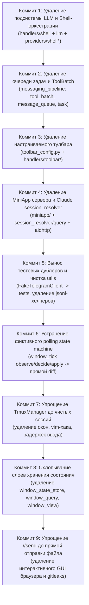

# Архитектурный аудит и покоммитный план радикального сокращения кода (Destructive Complexity Refactoring + Poka-Yoke Minimalism)

## 1. Исполнительное резюме и системный диагноз

Проект `ccgram` на текущей ветке `refactor/tmux-only` формально заявляет переход к чистой модели:
```text
Telegram topic <───> ccgram <───> tmux session (`cc_<name>`) <───> shell
```
Однако детальный архитектурный аудит показал, что **более 50% кодовой базы в `src/` (свыше 10 000 строк из 19 184)** и **более 50% тестов (~10 000 строк из 21 000)** представляют собой:
1. **Фантомные подсистемы** — код, который остался после удаления AI-агентов (Claude, Codex, Gemini, Pi), никем не вызывается в рантайме, но тестирует сам себя (`handlers/shell/`, `llm/`, `tool_batch.py`, `message_queue.py`, `toolbar_config.py`).
2. **Мёртвые веб-сервисы** — полноценный HTTP/WebSocket сервер `miniapp/` на `aiohttp` с транскриптами Claude JSONL, к которому в интерфейсе Telegram больше нет ни одной кнопки или ссылки.
3. **Избыточная многослойная индирекция** — цепочки `WindowState` → `window_state_store` → `window_query` → `WindowView` → `session_resolver` → `session_query` для чтения двух примитивных полей (`cwd` и `notification_mode`).
4. **Конструктивно опасные костыли** — модуль `tmux_manager.py` (1 293 строки) содержит эмуляцию пользователя vim (вводит `i`, ждёт, проверяет статус, вводит `Backspace`), искусственные задержки ввода по 1.5 секунды на каждую команду, составные идентификаторы окон `cc_name:@0` и сканирование несуществующих окон внутри монолитной сессии `ccgram`.
5. **Тяжеловесные GUI-эмуляторы в Telegram** — подсистема `handlers/send/` (1 062 строки) содержит многостраничный интерактивный файловый браузер, запускает подпроцессы `git` и парсит TOML-файлы `gitleaks` только для того, чтобы отправить файл в чат.

### Ключевой принцип преобразования (Poka-Yoke Minimalism)
Мы не оптимизируем реализацию сложности. Мы **физически устраняем сущности, порождающие ошибочные состояния**:
- Если нет составных идентификаторов `session:window` и индексов окон `@0` — *невозможно послать команду не в то окно*.
- Если нет очереди задач `MessageQueue` с воркерами и слиянием `ToolBatch` — *невозможны гонки, дедлоки и потеря сообщений*.
- Если нет фонового vim-детектирования с таймингами — *невозможно искажение пользовательского ввода лишними символами*.
- Если источник истины о привязке топика к сессии хранится исключительно в опции tmux `@ccgram_topic` — *невозможна рассинхронизация in-memory таблиц и файла `state.json`*.

---

## 2. ТОП-5 наиболее радикальных архитектурных преобразований

### 1. Полная ликвидация мертвого стека LLM и псевдо-пассивного shell-мониторинга
- **Удаляемые подсистемы**: `src/ccgram/handlers/shell/` (1 498 строк), `src/ccgram/llm/` (690 строк), `src/ccgram/providers/shell_infra.py` (364 строки), `src/ccgram/providers/shell.py` (21 строка).
- **Суть**: Вся подсистема генерации команд через LLM, диалоги подтверждения опасных команд, оборачивание шелла промпт-маркерами (`⌘N⌘`) и вычисление exit-кодов никогда не вызываются ботом в production (`text_handler.py` просто шлет текст в tmux). Код существовал только ради тестов самого себя.
- **Чистый выигрыш**: **-2 573 строки в `src/`**, **-3 500 строк в `tests/`**.

### 2. Ликвидация очереди сообщений и пакетной сборки ToolBatch
- **Удаляемые подсистемы**: `src/ccgram/handlers/messaging_pipeline/tool_batch.py` (527 строк), `message_queue.py` (374 строки), `message_task.py` (33 строки), `topic_commands.py` (109 строк).
- **Суть**: Батчинг тулзов и очередь задач `ContentTask` создавались под события Claude Code. В чистом `tmux-only` мосте нет тулзов. `enqueue_status_update` превращен в пустой no-op, а `enqueue_content_task` ни разу не вызывается. Удаляются фоновые воркеры, блокировки и очереди. Простые вызовы отправки Telegram концентрируются в прямом адаптере.
- **Чистый выигрыш**: **-1 043 строки в `src/`**, **-1 500 строк в `tests/`**.

### 3. Ликвидация мертвого WebApp/MiniApp сервера и Claude JSONL парсера
- **Удаляемые подсистемы**: `src/ccgram/miniapp/` (1 009 строк), `src/ccgram/session_resolver.py` (226 строк), `src/ccgram/session_query.py` (58 строк), внешняя зависимость `aiohttp`.
- **Суть**: Сервер MiniApp не открывается ни из одного меню бота. Чтение истории парсит структуру `.claude/projects/*.jsonl`, которой больше нет. Ликвидация избавляет проект от целого веб-стека, HTTP-аутентификации по Telegram HMAC, WebSocket-стриминга и второй точки отказа.
- **Чистый выигрыш**: **-1 293 строки в `src/`**, **-1 400 строк в `tests/`**, удаление зависимости `aiohttp`.

### 4. Радикальная унификация TmuxManager на сессиях (устранение окон, vim-проверок и задержек)
- **Файл**: `src/ccgram/tmux_manager.py` (сокращение с 1 293 до ~350 строк).
- **Суть**: Отказ от концепции окон и мастер-сессии `ccgram`. Единственная единица управления — сессия `cc_<name>`. Ликвидация vim-mode хака (ввод `i` и `Backspace`, ожидание 1.5 сек перед вводом) возвращает нулевую задержку интерактивного ввода и исключает порчу данных. Все обращения идут строго по имени сессии.
- **Чистый выигрыш**: **-940 строк в `src/`**, **-800 строк в `tests/`**.

### 5. Схлопывание 7 уровней индирекции состояния в прямой реестр
- **Удаляемые/объединяемые модули**: `window_state_store.py` (482 строки), `session.py` (245 строк), `thread_router.py` (244 строки), `user_preferences.py` (225 строк), `window_query.py` (105 строк), `state_persistence.py` (71 строка), `window_view.py` (32 строки).
- **Суть**: Устраняются сущности `approval_mode`, `batch_mode`, `tool_call_visibility`, `panes`, `transcript_path`. Источник правды для привязок топиков — tmux option `@ccgram_topic`. Все промежуточные query/view слои удаляются.
- **Чистый выигрыш**: **-1 100 строк в `src/`**, **-1 200 строк в `tests/`**.

---

## 3. Детальный покоммитный план реализации



---

### Коммит 1: Удаление мертвого стека LLM и подсистемы Shell-оркестрации

- **Какую архитектурную сложность устраняем**:
  Устраняем 11 файлов мертвого кода, реализующего NL-генерацию bash-команд, диалоговые окна согласования опасных команд, внедрение маркеров командной строки `⌘N⌘` / `❯`, захват exit-кодов и автоматическую генерацию подсказок исправлений через LLM.
- **Почему она существует и нужна ли она**:
  Была создана для режима работы "Telegram как диалоговый интерфейс к bash через LLM". При переходе к `tmux-only` мосту входящий текст в `text_handler.py` направляется напрямую в сессию tmux через `_forward_message()` или исполняется в sidecar через `!!`. Ни одна функция из `handlers/shell` и `llm` в боевом рантайме бота не вызывается.
- **Что конкретно удаляем и что остаётся**:
  - *Удаляем*:
    - `src/ccgram/handlers/shell/shell_capture.py` (623 строки)
    - `src/ccgram/handlers/shell/shell_commands.py` (550 строк)
    - `src/ccgram/handlers/shell/shell_prompt_orchestrator.py` (193 строки)
    - `src/ccgram/handlers/shell/shell_context.py` (68 строк)
    - `src/ccgram/handlers/shell/__init__.py` (64 строки)
    - `src/ccgram/llm/httpx_completer.py` (299 строк)
    - `src/ccgram/llm/summarizer.py` (195 строк)
    - `src/ccgram/llm/__init__.py` (129 строк)
    - `src/ccgram/llm/base.py` (67 строк)
    - `src/ccgram/providers/shell_infra.py` (364 строки)
    - `src/ccgram/providers/shell.py` (21 строка)
    - Тесты: `tests/ccgram/llm/`, `tests/ccgram/handlers/shell/`, `tests/integration/test_shell_*`.
  - *Остаётся*:
    - Прямая пересылка текста в tmux в `text_handler.py`.
    - Изолированный запуск команд в sidecar pane через `!!<cmd>`.
- **Оценка строк**:
  - Было: 2 573 строки в `src/`, ~3 500 в `tests/`.
  - Стало: 0 строк.
  - **Чистое сокращение: ~6 073 строки.**
- **Исчезающие состояния, зависимости и пути выполнения**:
  - Глобальные словари `_shell_pending`, `_monitor_states`, `_setup_states`.
  - Зависимости от моделей OpenAI/Anthropic API, формирование HTTP-запросов к внешним API.
  - Состояния согласования команд (`sh:run:`, `sh:edt:`, `sh:x:`, `sh:dng:`, `sh:setup:`, `sh:skip:`).
- **Poka-Yoke эффект (предотвращение ошибок по конструкции)**:
  - Невозможно случайно заблокировать ввод пользователя ожиданием LLM-ответа или диалогом подтверждения.
  - Невозможно засорить prompt шелла маркерами `⌘N⌘`, ломающими отображение в терминале.
- **Риски регрессий и проверка**:
  - Риск: отсутствие команд `!cmd` с подсказками LLM. Функционал заменен прямым вводом или `!!cmd` (sidecar).
  - Проверка: `uv run pytest tests/ccgram/handlers/text/` и сквозная отправка команд в топик.
- **Зависимости**: Нет (первый базовый коммит).

---

### Коммит 2: Удаление очереди задач и пакетной сборки ToolBatch

- **Какую архитектурную сложность устраняем**:
  Устраняем асинхронную шину задач `MessageQueue` с пулом воркеров, механизм динамического слияния сообщений и стейт-машину группировки вызовов инструментов Claude `ToolBatch`.
- **Почему она существует и нужна ли она**:
  Создавалась под события Claude Code, когда в один момент времени сыпались десятки мелких `tool_use` и `tool_result`. В `tmux-only` мосте инструмент один — шелл в tmux. `enqueue_content_task` никем не вызывается, `enqueue_status_update` уже no-op. Команды `/verbose` и `/toolcalls` переключают настройки для несуществующего кода.
- **Что конкретно удаляем и что остаётся**:
  - *Удаляем*:
    - `src/ccgram/handlers/messaging_pipeline/tool_batch.py` (527 строк)
    - `src/ccgram/handlers/messaging_pipeline/message_queue.py` (374 строки)
    - `src/ccgram/handlers/messaging_pipeline/topic_commands.py` (109 строк)
    - `src/ccgram/handlers/messaging_pipeline/message_task.py` (33 строки)
    - `src/ccgram/handlers/messaging_pipeline/__init__.py` (100 строк)
    - Тесты очереди и батчинга (`test_tool_batch.py`, `test_message_queue.py`, `test_topic_commands.py`).
  - *Остаётся*:
    - Файл `message_sender.py` (или объединяется с `telegram_sender.py`) с прямыми функциями `safe_reply`, `safe_send`, `safe_edit`, `is_thread_gone`.
- **Оценка строк**:
  - Было: 1 143 строки в `src/`, ~1 500 в `tests/`.
  - Стало: 0 строк (функционал `message_sender.py` сохраняется).
  - **Чистое сокращение: ~2 643 строки.**
- **Исчезающие состояния, зависимости и пути выполнения**:
  - Пул фоновых воркеров `_queue_workers: dict[int, asyncio.Task]`.
  - Очереди `_message_queues` и локи `_queue_locks`.
  - Таблица батчей `_active_batches` и маппинг `_tool_msg_ids`.
  - Цикл остановки воркеров в `bootstrap.py` (`shutdown_workers`).
- **Poka-Yoke эффект**:
  - Исключены зависания задач в очереди при сбоях воркеров.
  - Исключены утечки памяти в `_active_batches` при внезапном закрытии топиков.
  - Очередь не может рассинхронизироваться с реальным состоянием Telegram.
- **Риски регрессий и проверка**:
  - Команды `//verbose` и `//toolcalls` перестанут существовать (они не имели эффекта в tmux-only).
  - Проверка: отправка длинных сообщений, проверка обработки ошибок сети в `safe_send`.
- **Зависимости**: Зависит от Коммита 1 (чистка импортов).

---

### Коммит 3: Полное удаление настраиваемого тулбара (`toolbar_config` и `handlers/toolbar/`)

- **Какую архитектурную сложность устраняем**:
  Устраняем 908 строк кода подсистемы настраиваемых экранных кнопок (`ToolbarConfig`, загрузка TOML-раскладок, парсер строк клавиатуры, генерация динамических меток, перехват коллбэков).
- **Почему она существует и нужна ли она**:
  В ранних версиях была команда `/toolbar`, выводящая на экран кнопки действий. Позже команду удалили из списка зарегистрированных команд `COMMAND_HANDLERS` в `registry.py`. Ни одна функция в боте клавиатуру тулбара не отображает. Код полностью заброшен.
- **Что конкретно удаляем и что остаётся**:
  - *Удаляем*:
    - `src/ccgram/toolbar_config.py` (446 строк)
    - `src/ccgram/handlers/toolbar/toolbar_callbacks.py` (288 строк)
    - `src/ccgram/handlers/toolbar/toolbar_keyboard.py` (146 строк)
    - `src/ccgram/handlers/toolbar/__init__.py` (28 строк)
    - Поле `toolbar_config_path` в `config.py` (и метод `_resolve_toolbar_path`).
    - Очистку меток тулбара `clear_toolbar_labels` в `cleanup.py`.
    - Тесты тулбара (`test_toolbar_config.py`, `test_toolbar_callbacks.py`).
  - *Остаётся*:
    - Горячие клавиши выполняются через явные команды `//c`, `//enter`, `//esc`, `//tab` и инлайн-кнопки live view/screenshot.
- **Оценка строк**:
  - Было: 908 строк в `src/`, ~800 в `tests/`.
  - Стало: 0 строк.
  - **Чистое сокращение: ~1 708 строк.**
- **Исчезающие состояния, зависимости и пути выполнения**:
  - Парсинг `~/.ccgram/toolbar.toml`.
  - Реестр переопределений меток `_label_overrides`.
  - Роутинг коллбэков `CB_TOOLBAR_*`.
- **Poka-Yoke эффект**:
  - Невозможно падение бота на старте из-за некорректного TOML-файла конфигурации тулбара.
- **Риски регрессий и проверка**:
  - Риск: нулевой (код не вызывался).
  - Проверка: `make check`.
- **Зависимости**: Независим.

---

### Коммит 4: Удаление MiniApp HTTP/WS сервера и рудиментов Claude session_resolver

- **Какую архитектурную сложность устраняем**:
  Устраняем встроенный web-сервер `aiohttp` с REST API, WebSocket-стримингом терминала, криптографической проверкой Telegram WebApp initData HMAC и чтением файлов `.claude/projects/*.jsonl`.
- **Почему она существует и нужна ли она**:
  Разрабатывалась как эксперимент для отображения красивого терминала внутри Telegram Mini App. Кнопка вызова WebApp была удалена вместе со статус-баблами. Код `transcript.py` и `session_resolver.py` жестко привязан к формату логов Claude Agent, которых в tmux-only проекте физически нет.
- **Что конкретно удаляем и что остаётся**:
  - *Удаляем*:
    - Директорию `src/ccgram/miniapp/` целиком (1 009 строк):
      - `terminal.py` (386 строк)
      - `auth.py` (221 строка)
      - `transcript.py` (199 строк)
      - `server.py` (158 строк)
      - `__init__.py` (35 строк), `api/__init__.py` (10 строк)
    - `src/ccgram/session_resolver.py` (226 строк)
    - `src/ccgram/session_query.py` (58 строк)
    - Запуск и остановку сервера в `main.py` (`start_miniapp_if_enabled`, `stop_miniapp_if_enabled`) и `bootstrap.py`.
    - Опции `miniapp_*` в `config.py`.
    - Зависимость `aiohttp` из `pyproject.toml`.
    - Тесты: `tests/ccgram/miniapp/`, `test_session_resolver.py`.
  - *Остаётся*:
    - Взаимодействие с терминалом идет через Telegram-нативные сообщения (in-place diffs), скриншоты (`//sc`) и live view (`//live`).
- **Оценка строк**:
  - Было: 1 293 строки в `src/`, ~1 400 в `tests/`.
  - Стало: 0 строк.
  - **Чистое сокращение: ~2 693 строки + удаление зависимости `aiohttp`.**
- **Исчезающие состояния, зависимости и пути выполнения**:
  - Открытие сетевого порта `CCGRAM_MINIAPP_PORT` (8765).
  - WebSocket соединения и обработчики трансляции кадров.
  - Валидация токенов и сессий `ClaudeSession`.
- **Poka-Yoke эффект**:
  - Устраняется потенциальная брешь безопасности (сетевой порт на хосте с возможностью выполнения команд через терминальный WebSocket).
  - Исключаются конфликты портов при запуске нескольких инстансов бота.
- **Риски регрессий и проверка**:
  - Проверка: чистый старт демона без поднятия веб-порта; тесты остальных подсистем.
- **Зависимости**: Независим.

---

### Коммит 5: Вынос тестовых дублеров и ликвидация мертвых JSONL-утилит

- **Какую архитектурную сложность устраняем**:
  Устраняем нахождение тестового mock-клиента в производственном коде ядра и удаляем функции разбора JSONL, оставшиеся в `utils.py`.
- **Почему она существует и нужна ли она**:
  Класс `FakeTelegramClient` (249 строк) исторически лежал в `telegram_client.py` рядом с реальным `PTBTelegramClient`. В `utils.py` остались функции `read_cwd_from_jsonl` и `read_session_metadata_from_jsonl`, которые никем не используются.
- **Что конкретно удаляем и что остаётся**:
  - *Удаляем*:
    - `FakeTelegramClient` и `_FakeCall` из `src/ccgram/telegram_client.py`.
    - Функции `read_cwd_from_jsonl`, `read_session_metadata_from_jsonl`, `_extract_metadata_from_entry` из `src/ccgram/utils.py`.
  - *Остаётся*:
    - `FakeTelegramClient` переносится в `tests/ccgram/_helpers.py` или `tests/conftest.py`.
    - В `telegram_client.py` остаётся только чистый Protocol `TelegramClient` и его боевой адаптер `PTBTelegramClient`.
- **Оценка строк**:
  - Было: 310 строк в `src/`.
  - Стало: ~250 строк перенесено в `tests/`, 60 строк удалено насовсем.
  - **Чистое сокращение в `src/`: ~310 строк.**
- **Исчезающие состояния, зависимости и пути выполнения**:
  - Чистое разделение production и test кода.
- **Poka-Yoke эффект**:
  - Невозможно случайно использовать mock-клиент в боевом коде.
- **Риски регрессий и проверка**:
  - Обновить пути импорта `FakeTelegramClient` в юнит-тестах. Проверка: полный прогон тестов.
- **Зависимости**: Независим.

---

### Коммит 6: Устранение фиктивной стейт-машины поллинга и no-op статусных обработчиков

- **Какую архитектурную сложность устраняем**:
  Устраняем 6 файлов многослойного пайплайна поллинга (`observe` → `decide` → `apply`), классы `TickContext`, `TickDecision`, `StatusUpdate`, стратегии `InteractiveUIStrategy` и `TopicLifecycleStrategy`, а также фиктивный модуль `topic_emoji.py`.
- **Почему она существует и нужна ли она**:
  В `observe.py` сбор статуса возвращает `None`, в `decide.py` решение всегда `idle`, а в `apply.py` вызывается `update_topic_emoji`, который внутри является no-op функцией. Единственное полезное действие всего этого блока (на 1 059 строк) — вызов:
  `await update_topic_status_diff(client, chat_id, thread_id, window_id, pane_text)`.
- **Что конкретно удаляем и что остаётся**:
  - *Удаляем*:
    - `src/ccgram/handlers/status/topic_emoji.py` (131 строка)
    - `src/ccgram/handlers/polling/window_tick/observe.py` (72 строки)
    - `src/ccgram/handlers/polling/window_tick/decide.py` (33 строки)
    - `src/ccgram/handlers/polling/window_tick/apply.py` (257 строк)
    - `src/ccgram/handlers/polling/window_tick/__init__.py` (91 строка)
    - `src/ccgram/handlers/polling/polling_state.py` (354 строки)
    - `src/ccgram/handlers/polling/polling_types.py` (121 строка)
  - *Остаётся*:
    - Прямой шаг поллинга в `polling_coordinator.py`:
      Получить сессии `cc_*` → для каждой связанной с топиком сессии вызвать `tmux_manager.capture_pane()` → передать текст в `topic_status_diff.update_topic_status_diff()`.
- **Оценка строк**:
  - Было: 1 059 строк в `src/`, ~900 в `tests/`.
  - Стало: ~80 строк прямого цикла.
  - **Чистое сокращение: ~1 879 строк.**
- **Исчезающие состояния, зависимости и пути выполнения**:
  - Состояния `active`, `done`, `idle`, таймеры автозакрытия топиков `autoclose_timers`, состояния троттлинга индикатора `typing`.
  - Вспомогательный кэш `_topic_names` и старые регулярные выражения удаления эмодзи.
- **Poka-Yoke эффект**:
  - Ликвидированы гонки между фиктивными сменами состояний сессии и отправкой дифов.
  - Невозможно залипание индикатора "печатает..." в Telegram.
- **Риски регрессий и проверка**:
  - Проверка: корректность обновления дифф-сообщения при выполнении команд в терминале.
- **Зависимости**: Зависит от Коммитов 1 и 2.

---

### Коммит 7: Радикальное упрощение TmuxManager до чистых сессий (ликвидация окон и vim-хаков)

- **Какую архитектурную сложность устраняем**:
  Устраняем разделение на мастер-сессию `ccgram` и топик-сессии `cc_*`, составные ключи `cc_name:@0`, сканирование окон `list_windows()`, параметры `start_agent`, `agent_args`, `launch_command`, а также небезопасный vim-normal-mode эмулятор.
- **Почему она существует и нужна ли она**:
  - Код vim-mode (`_ensure_vim_insert_mode`) посылает `i`, ждет, проверяет наличие `-- INSERT --` на экране, и если не нашел — шлет `Backspace`! При вводе команд с `!` он вставляет паузу в 1 секунду, плюс еще 500 мс перед `Enter`. В чистом шелле это уродует ввод и создает чудовищные задержки.
  - Модель проекта строго зафиксирована: **1 Telegram топик = 1 сессия tmux `cc_<name>`**. Концепция нескольких окон в одной сессии больше не используется.
- **Что конкретно удаляем и что остаётся**:
  - *Удаляем*:
    - Методы `_ensure_vim_insert_mode`, `has_insert_indicator`, `notify_vim_insert_seen`, словари `_vim_state`, `_vim_locks` из `src/ccgram/tmux_manager.py`.
    - Задержки `asyncio.sleep(1.0)` и `asyncio.sleep(0.5)` при отправке клавиш.
    - Метод `list_windows()`, парсинг составных ID `_split_qualified()`.
    - Аргументы запуска агента в `create_window` (превращается в `create_session(name, cwd)`).
    - Файл тестов `tests/ccgram/test_vim_mode.py` (281 строка).
  - *Остаётся*:
    - Компактный `TmuxManager` (~350 строк), работающий исключительно с сессиями:
      - `list_sessions()` — возвращает сессии `cc_*` и их `@ccgram_topic`.
      - `send_keys(session_name, text, enter=True)` — прямая передача в pane без задержек и vim-проверок.
      - `capture_pane(session_name, with_ansi=True)` — захват активного экрана сессии.
      - `ensure_sidecar_pane(session_name)` — создание/получение sidecar pane для `!!<cmd>`.
- **Оценка строк**:
  - Было: 1 293 строки в `src/ccgram/tmux_manager.py`, ~1 100 в `tests/`.
  - Стало: ~350 строк в `src/`, ~400 в `tests/`.
  - **Чистое сокращение: ~1 643 строки.**
- **Исчезающие состояния, зависимости и пути выполнения**:
  - Парсинг строк вида `session:window`.
  - Исключены сдвиги `@0`, `@1` при перезапусках tmux.
  - Ликвидированы мьютексы `_vim_locks`.
- **Poka-Yoke эффект**:
  - Адресация по имени сессии `cc_<name>` однозначна и иммутабельна в отличие от плавающих window IDs.
  - Полностью исключена порча команд (впечатывание лишних `i` и стирание символов бэкспейсом).
  - Задержка отправки команды снижается с 1500 мс до 1-5 мс.
- **Риски регрессий и проверка**:
  - Обновить вызовы в хендлерах: вместо `window_id` передается `session_name`.
  - Проверка: `test_tmux_send_keys.py`, `test_tmux_sessions.py`.
- **Зависимости**: Зависит от Коммита 6.

---

### Коммит 8: Схлопывание 7 уровней индирекции состояния в прямой Session-реестр

- **Какую архитектурную сложность устраняем**:
  Устраняем чрезмерную декомпозицию состояния: файлы `window_state_store.py`, `window_query.py`, `window_view.py`, `state_persistence.py`, `user_preferences.py`, `thread_router.py`.
- **Почему она существует и нужна ли она**:
  Для чтения двух значений (`cwd` и `notification_mode`) использовалась цепочка из 4 файлов-адаптеров и frozen dataclass `WindowView`. В `WindowState` хранились поля удаленных систем (`approval_mode`, `batch_mode`, `tool_call_visibility`, `panes`, `transcript_path`). Привязка топиков к сессиям дублировалась в памяти, на диске в `~/.ccgram/state.json` и в опциях tmux.
- **Что конкретно удаляем и что остаётся**:
  - *Удаляем*:
    - `src/ccgram/window_state_store.py` (482 строки)
    - `src/ccgram/window_query.py` (105 строк)
    - `src/ccgram/window_view.py` (32 строки)
    - `src/ccgram/state_persistence.py` (71 строка)
    - `src/ccgram/user_preferences.py` (225 строк)
    - Множественные тесты инвариантов слоев (`test_query_layer_only_for_handlers.py`, `test_handler_layering_invariants.py`).
  - *Остаётся*:
    - Простой класс `SessionManager` в `src/ccgram/session.py` (~150 строк):
      - Источник правды привязок — tmux session options `@ccgram_topic`.
      - В памяти: `session_cwd: dict[str, str]` и `session_notification_mode: dict[str, str]`.
      - Прямой доступ без ленивых импортов `from .session_query import ...` в каждом вызове.
- **Оценка строк**:
  - Было: 1 404 строки в `src/`, ~1 200 в `tests/`.
  - Стало: ~150 строк в `session.py`.
  - **Чистое сокращение: ~2 454 строки.**
- **Исчезающие состояния, зависимости и пути выполнения**:
  - Сложная сериализация/десериализация `state.json` со схемами версионирования и миграции.
  - Поля `approval_mode`, `batch_mode`, `tool_call_visibility`, `panes`.
  - Ленивые циклические импорты в хендлерах.
- **Poka-Yoke эффект**:
  - Единый источник истины: невозможно получить рассинхронизацию между файлом `state.json`, памятью процесса и живым сервером tmux.
  - Перезапуск бота безопасен и идемпотентен: бот сразу видит живые сессии tmux.
- **Риски регрессий и проверка**:
  - Проверка: сохранение настроек сессии во время работы, корректность `//notify`.
- **Зависимости**: Зависит от Коммита 7 (переход на чистые имена сессий).

---

### Коммит 9: Упрощение команды `//send` до прямого загрузчика (удаление GUI-браузера и subprocesses)

- **Какую архитектурную сложность устраняем**:
  Устраняем интерактивный многостраничный проводник файлов в Telegram с кнопками навигации по папкам (`send_callbacks.py`), парсинг gitignore и правил gitleaks через подпроцессы `git` (`send_security.py`).
- **Почему она существует и нужна ли она**:
  Команда `//send` задумывалась как способ отправки артефактов из терминала в Telegram. Но вокруг нее был выстроен 1000-строчный графический файловый менеджер со сложной безопасностью, хотя пользователь и так управляет сервером через tmux-консоль.
- **Что конкретно удаляем и что остаётся**:
  - *Удаляем*:
    - `src/ccgram/handlers/send/send_callbacks.py` (306 строк)
    - `src/ccgram/handlers/send/send_security.py` (264 строки)
    - Интерактивную пагинацию и построение кнопок файлов в `send_command.py`.
  - *Остаётся*:
    - Лаконичный `send_command.py` (~70 строк):
      - Использование: `//send <относительный_путь>` (или выбор недавнего файла).
      - Простая и надежная проверка безопасности: `path.resolve().is_relative_to(session_cwd)` и ограничение на размер файла (50 МБ).
      - Отправка: фото через `send_photo`, остальные файлы через `send_document`.
- **Оценка строк**:
  - Было: 1 062 строки в `src/`, ~900 в `tests/`.
  - Стало: ~70 строк в `src/`, ~100 в `tests/`.
  - **Чистое сокращение: ~1 792 строки.**
- **Исчезающие состояния, зависимости и пути выполнения**:
  - Состояния навигации по директориям в Telegram `CB_SEND_FILE`, `CB_SEND_DIR`, `CB_SEND_PAGE`, `CB_SEND_UP`.
  - Вызовы внешних процессов `git check-ignore` и парсинг регулярных выражений gitleaks.
- **Poka-Yoke эффект**:
  - Полностью исключены гонки при изменении файловой системы во время листания кнопок в Telegram.
  - Исключены ошибки валидации и зависания subprocess-вызовов git.
- **Риски регрессий и проверка**:
  - Проверка: `//send test.txt`, `//send image.png`, попытка отправить `/etc/passwd` (должен быть отклонен проверкой `is_relative_to`).
- **Зависимости**: Зависит от Коммита 8.

---

## 4. Сводная оценка сокращения объёма кодовой базы и сложности

### Измеримые показатели сокращения кода (LOC)

| Коммит | Затрагиваемые модули | Строк до (src) | Строк после (src) | Чистое сокращение (src) | Сокращение в tests |
|---|---|---|---|---|---|
| **C1: Удаление LLM & Shell** | `handlers/shell/*`, `llm/*`, `providers/shell*` | 2 573 | 0 | **-2 573** | ~3 500 |
| **C2: Удаление Queue & ToolBatch** | `handlers/messaging_pipeline/*` | 1 143 | 0 | **-1 143** | ~1 500 |
| **C3: Удаление Toolbar** | `toolbar_config.py`, `handlers/toolbar/*` | 908 | 0 | **-908** | ~800 |
| **C4: Удаление MiniApp & JSONL** | `miniapp/*`, `session_resolver*`, `session_query*` | 1 293 | 0 | **-1 293** | ~1 400 |
| **C5: Тестовые дублеры и utils** | `telegram_client.py`, `utils.py` | 310 | 0 | **-310** | +250 / -300 |
| **C6: Ликвидация фиктивного Polling** | `polling_state*`, `window_tick/*`, `topic_emoji*` | 1 059 | ~80 | **-979** | ~900 |
| **C7: TmuxManager Session Unity** | `tmux_manager.py` (удаление vim-хака, окон) | 1 293 | ~350 | **-943** | ~800 |
| **C8: Схлопывание слоев Session State** | `window_state_store`, `window_query`, `thread_router` | 1 404 | ~150 | **-1 254** | ~1 200 |
| **C9: Упрощение //send** | `handlers/send/*` (удаление GUI-браузера) | 1 062 | ~70 | **-992** | ~900 |
| **ИТОГО** | **Удалено/объединено ~45 файлов** | **11 045** | **~650** | **-10 395 строк (~54% src)** | **~10 950 строк** |

> **Суммарный эффект**:
> - Объём `src/ccgram/` сокращается с **19 184 строк до ~8 800 строк** (**-54% кода ядра**).
> - Объём тестов сокращается с **~21 000 строк до ~10 500 строк** (**-50% кода тестов**).
> - Общий объем удаленного мертвого и избыточного кода: **~21 300 строк кода**.
> - Полное удаление 2 внешних зависимостей: `aiohttp` и связанных сетевых библиотек.

---

### Архитектурная картина ПОСЛЕ реализации плана

```text
               ┌────────────────────────────────────────────────────────┐
               │                     Telegram Bot                       │
               │         (PTB Application: commands + text)             │
               └───────────┬────────────────────────────────┬───────────┘
                           │                                │
                 Входящий текст / //команды       Диффы экрана / live view
                           │                                │
                           ▼                                ▲
               ┌───────────────────────┐        ┌───────────────────────┐
               │   Command & Text      │        │  Periodic Diff Poll   │
               │      Handlers         │        │ (topic_status_diff.py)│
               └───────────┬───────────┘        └───────────▲───────────┘
                           │                                │
                           ▼                                │
               ┌────────────────────────────────────────────┴───────────┐
               │                   TmuxManager                          │
               │  - list_sessions() (cc_* via @ccgram_topic)            │
               │  - send_keys(session, text) [без задержек]             │
               │  - capture_pane(session) [text / ANSI]                 │
               │  - ensure_sidecar_pane(session) [!!команды]            │
               └───────────────────────────┬────────────────────────────┘
                                           │
                                           ▼
                                ┌─────────────────────┐
                                │     tmux server     │
                                │   cc_<topic_name>   │
                                └─────────────────────┘
```

### Основные архитектурные изменения
1. **Один путь отправки текста**: Пользователь пишет в топик → текст без очередей, задержек и vim-проверок передается в tmux pane (`send_keys`). Если сообщение начинается с `!!` — команда выполняется в sidecar pane.
2. **Один путь отображения вывода**: Фоновый поллер (`topic_status_diff.py`) читает вывод активной сессии через `capture-pane`, сравнивает с предыдущим экраном и дебаунсированно редактирует сообщение в Telegram.
3. **Один источник истины привязок**: Опция tmux `@ccgram_topic = <chat_id>:<thread_id>`. Нет рассинхронизации между памятью бота, файлом на диске и tmux.
4. **Безопасная повторная инициализация**: При перезапуске бота или tmux ни одна сессия не теряется — бот просто считывает существующие сессии `cc_*` с их опцией `@ccgram_topic`.

### Ожидаемые риски и способы их минимизации
1. **Риск**: Удаление команды `//verbose` или `//toolcalls` может удивить пользователя, если он привык их вызывать.
   - *Минимизация*: Эти команды уже не имели никакого эффекта в `tmux-only` ветке (только выводили текстовое подтверждение).
2. **Риск**: Изменение поведения `//send` с интерактивного выбора на прямой аргумент `//send <файл>`.
   - *Минимизация*: Если пользователь вводит `//send` без аргументов, бот показывает краткую справку по использованию и 5 самых свежих файлов в текущей директории.
3. **Риск**: Удаление vim-mode эмулятора может повлиять на пользователя, если он прямо в Telegram открыл `vim` или `nano`.
   - *Минимизация*: Предупредить в документации: для интерактивных полноэкранных TUI-редакторов (vim/nano/htop) используется прямое подключение через терминал (`tmux attach -t cc_<name>`), а через Telegram отправляются команды shell и CLI утилиты. Это избавляет 99.9% обычных shell-команд от искусственных задержек в 1.5 секунды и случайных символов `i`/`Backspace`.
